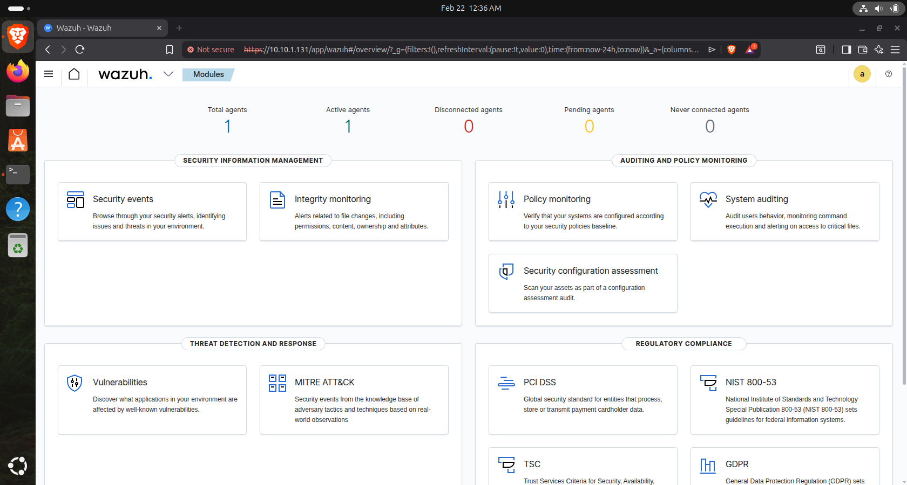
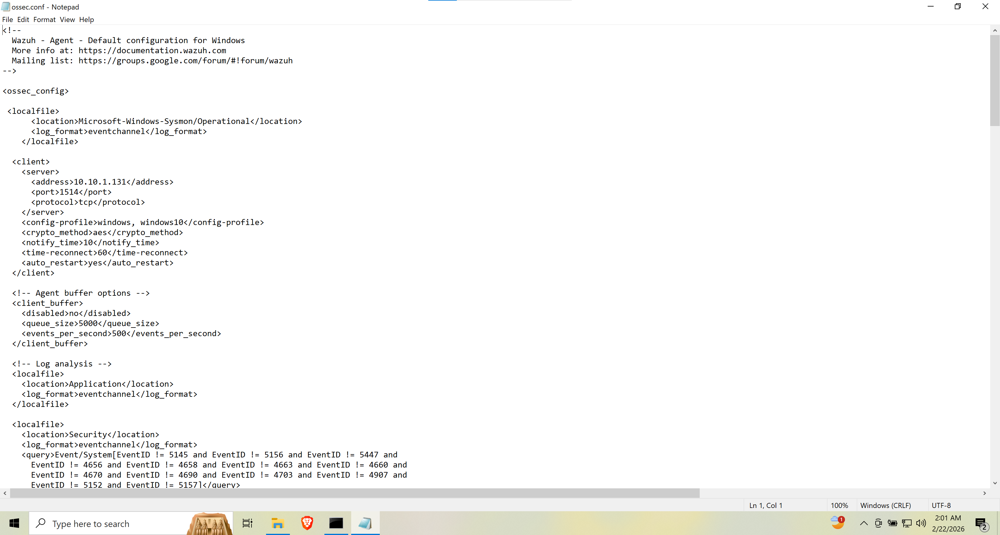
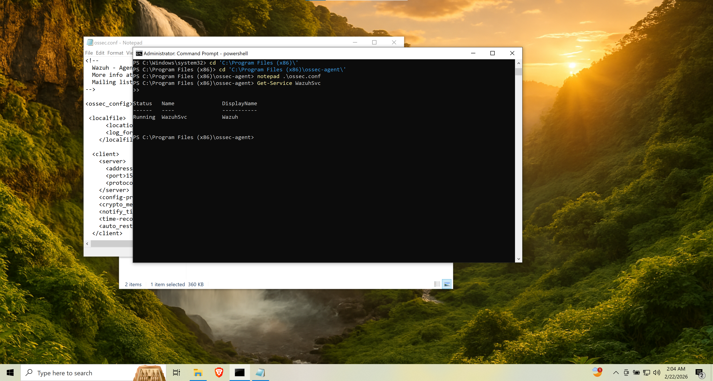
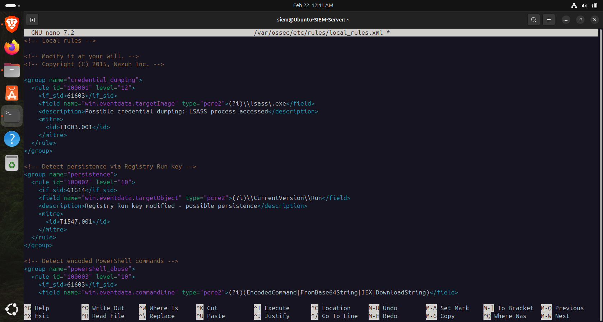
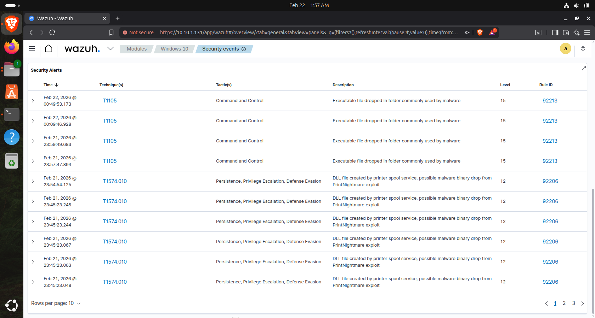
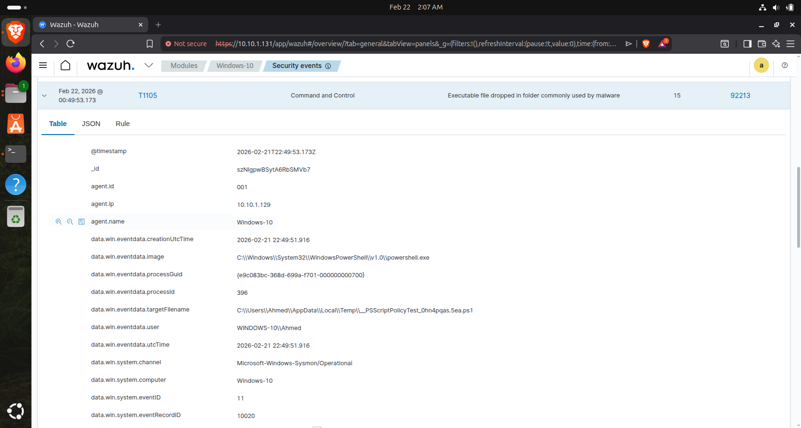

# Wazuh Home Lab for Endpoint Monitoring

This lab provides a simple & easy-to-understand home lab setup for **Wazuh** and **Sysmon**.

Wazuh is an open-source security monitoring platform that acts as an EDR, HIDS, and SIEM. Sysmon provides granular Windows endpoint telemetry. In this guide, I'll walk through deploying a Wazuh Manager, configuring a Windows Endpoint with Sysmon and a Wazuh Agent, creating custom detection rules, and simulating malware techniques to trigger those rules.

## My Wazuh Home Lab Setup
For this lab, I used a virtualized environment to simulate attacking and defending an endpoint.

- **Wazuh Manager**: I installed **Wazuh All-in-One** on an **Ubuntu 24.04 LTS** server. This acts as the centralized manager and dashboard for receiving and alerting on logs.
- **Windows Endpoint**: I used a **Windows 10** virtual machine acting as the target endpoint. I installed **Sysmon** with the SwiftOnSecurity configuration for detailed logging, and the **Wazuh Agent** to forward telemetry to the manager.

I aim to create a simple, instructional guide that’s easy to use, reflecting my own learning experience. This setup mirrors my learning of EDR capabilities and how to write custom detection rules mapped to MITRE ATT&CK.

## Prerequisites
- A host computer (Ubuntu 24.04) for installing Wazuh Manager.
- A client computer (Windows 10) for installing Sysmon and Wazuh Agent.
- Basic Windows Event Logs and Sysmon knowledge.

---

## Step 1: Install Wazuh Manager on the Ubuntu Server
1.  **Download & Install**: I used the Wazuh Quick Install script to install the Manager, Indexer, and Dashboard.
    ```bash
    curl -sO https://packages.wazuh.com/4.7/wazuh-install.sh
    sudo bash wazuh-install.sh -a
    ```
2.  **Access Dashboard**: Once installed, I noted the admin password generated by the script and accessed the Wazuh Dashboard at `https://<Manager-IP>`.
    

## Step 2: Install Sysmon & Wazuh Agent on the Windows Endpoint
1.  **Sysmon Setup**: I downloaded Sysmon and the SwiftOnSecurity XML configuration, then installed it via PowerShell (Admin).
    ```powershell
    .\Sysmon64.exe -accepteula -i sysmonconfig.xml
    ```
2.  **Wazuh Agent Installation**: I downloaded the Wazuh Windows Agent and installed it, pointing it to the Wazuh Manager's IP.
    ```powershell
    msiexec /i wazuh-agent.msi /q WAZUH_MANAGER="<MANAGER-IP>"
    NET START WazuhSvc
    ```
3.  **Configure Sysmon Ingestion**: I edited the Wazuh Agent (`ossec.conf`) file to ingest the Sysmon operational event channel and then restarted the service.
    
4.  **Verify Connection**: I checked the Wazuh Dashboard under **Agents** to verify the Windows machine appeared as **Active**.
    

## Step 3: Add Custom Detection Rules
By default, Wazuh has many rules, but to detect advanced techniques specifically using Sysmon logs, I added custom rules on the manager.
1.  **Edit Rules**: I SSH'd into the manager and added rules to `/var/ossec/etc/rules/local_rules.xml` covering:
    - **Credential Dumping**: Access to `lsass.exe`.
    - **Persistence**: Registry Run key modifications and Scheduled Tasks generation.
    - **Execution**: Encoded PowerShell commands.
2.  **Restart Manager**: I restarted the Wazuh Manager to apply the new rules.
    

## Step 4: Simulate Attacks on the Endpoint
1.  **Credential Dumping**: I used `rundll32` and `comsvcs.dll` to dump the LSASS memory, mimicking Mimikatz behavior.
    ```powershell
    rundll32.exe C:\Windows\System32\comsvcs.dll, MiniDump (Get-Process lsass).Id C:\temp\lsass.dmp full
    ```
2.  **Persistence**: I modified the `CurrentVersion\Run` registry key and created a scheduled task.
3.  **Encoded PowerShell**: I ran a base64 encoded PowerShell command to simulate defense evasion.

## Step 5: Monitor & Analyze Alerts
1.  **Security Events**: Back in the Wazuh Dashboard, I navigated to **Security Events** and filtered by high-level alerts (Level >= 10).
2.  **Verify Detections**: I confirmed that my custom rules triggered for credential dumping, registry modifications, and suspicious PowerShell execution.
    
3.  **Investigate Alert Details**: I expanded the alerts to investigate the rich telemetry provided by Sysmon, analyzing fields like `win.eventdata.image`, `win.eventdata.commandLine`, and the mapped MITRE ATT&CK IDs directly within the dashboard.
    

---

## Conclusion
This lab demonstrates the power of pairing Sysmon's deep endpoint visibility with Wazuh's centralized alerting and custom rule capabilities. While commercial EDRs provide out-of-the-box detections, building these rules manually highlights the importance of process tree analysis and MITRE ATT&CK mapping. This free stack effectively replicates a SOC environment for endpoint threat detection.

## License
This project is licensed under the **MIT License**. See the [LICENSE](LICENSE) file for details.
